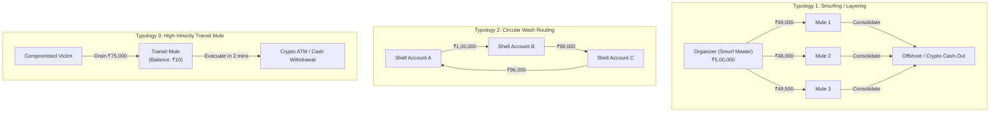

# Interview Preparation & Graph AI Technical Architecture Guide
## NPCI Market Innovation & NVIDIA AI Systems Deep Dive

> **Repository:** `payment-graph-mule-detection`  
> **Key Themes:** Graph Neural Networks (GNN), GraphSAGE, GAT, Message Passing, Graph Heterophily in Fraud, Money Mule Typologies, Non-GNN Graph Baselines

---

## 1. Mathematical Foundations of Graph Neural Networks

### 1.1 The General Message Passing Neural Network (MPNN) Framework
At layer $k$, the representation $h_v^{(k)}$ of node $v$ is updated via two steps:

$$\mathbf{m}_{\mathcal{N}(v)}^{(k)} = \text{AGGREGATE}^{(k)}\left(\{ \mathbf{M}^{(k)}(h_v^{(k-1)}, h_u^{(k-1)}, e_{vu}) : u \in \mathcal{N}(v) \}\right)$$

$$h_v^{(k)} = \text{UPDATE}^{(k)}\left(h_v^{(k-1)}, \mathbf{m}_{\mathcal{N}(v)}^{(k)}\right)$$

Where:
* $\mathcal{N}(v)$ is the immediate 1-hop neighborhood of account $v$.
* $e_{vu}$ represents transaction edge attributes (amount, timestamp, channel).
* $\mathbf{M}^{(k)}$ is the message function.

---

### 1.2 Graph Convolutional Networks (GCN) vs. GraphSAGE vs. GAT

| Architecture | Aggregation Operator | Formulation | Strengths & Vulnerabilities in Fraud |
| :--- | :--- | :--- | :--- |
| **GCN** (Kipf & Welling) | Symmetric Normalized Sum | $h_v^{(k)} = \sigma\left(\sum_{u \in \tilde{\mathcal{N}}(v)} \frac{1}{\sqrt{\tilde{d}_v \tilde{d}_u}} W h_u^{(k-1)}\right)$ | **Transductive, homophilic.** Vulnerable to *over-smoothing* when fraud nodes connect to benign nodes. |
| **GraphSAGE** (Hamilton et al.) | Inductive Concatenation + Sampling | $h_v^{(k)} = \sigma\left(W \cdot \left[ h_v^{(k-1)} \,\|\, \text{MEAN}(\{h_u^{(k-1)} : u \in \mathcal{N}_S(v)\}) \right]\right)$ | **Inductive, scalable.** Preserves node identity via explicit concatenation $[h_v \,\|\, h_{\mathcal{N}}]$. |
| **GAT** (Veličković et al.) | Multi-Head Attention | $h_v^{(k)} = \sigma\left(\sum_{u \in \mathcal{N}(v)} \alpha_{vu} W h_u^{(k-1)}\right)$ | **Edge-selective.** Attention coefficients $\alpha_{vu}$ down-weight noisy benign transactions. |

---

## 2. The Core Technical Challenge: Heterophily & Over-Smoothing in Fraud Graphs

### Q1: Why does standard GCN underperform on payment fraud compared to citation networks?
> **Answer:**  
> "Citation and social networks exhibit high **homophily**—nodes with the same label naturally connect to one another ('birds of a feather flock together').  
> 
> Payment networks, however, exhibit high **heterophily**:
> 1. Fraudsters and compromised accounts interact primarily with **legitimate victims, payment gateways, and innocent merchants** to evacuate funds.
> 2. Direct fraud-to-fraud edges are minimized by organized syndicates to avoid heuristic blacklists.
> 
> Because GCN performs symmetric normalized averaging across the neighborhood, it dilutes the anomalous features of a fraudulent node with the benign features of its neighbors. This leads to **over-smoothing**, where representations of normal and fraud nodes become indistinguishable.  
> 
> **How we solve it:**
> 1. We use **GraphSAGE**, which explicitly concatenates the node's own state $[h_v \,\|\, h_{\mathcal{N}}]$ rather than averaging it away.
> 2. We use **GAT**, which learns non-uniform attention weights $\alpha_{vu}$, dynamically isolating suspicious payment pathways."

---

## 3. Money-Laundering & Mule Typologies

### Q2: What exact topological metrics detect smurfing without deep learning?
> **Answer:**  
> "Before deploying GNNs, we engineer domain-informed network features:
> 1. **Pass-Through Ratio:** $\frac{\min(\text{Inbound Volume}, \text{Outbound Volume})}{\max(\text{Inbound Volume}, \text{Outbound Volume})}$. A legitimate user has savings or spends over time; a transit mule has a ratio $\approx 0.98$ (money in = money out).
> 2. **In/Out Degree Ratio:** $\frac{\text{In-Degree} + 1}{\text{Out-Degree} + 1}$. Distinguishes disbursement organizers (low ratio) from consolidator sinks (high ratio) and transit mules (ratio $\approx 1.0$).
> 3. **Holding Duration / Transaction Span:** The time interval between first inbound and outbound transfers. Mules exhibit low holding durations (often $< 15$ minutes).
> 4. **PageRank & Clustering Centrality:** Identifies participation in densely connected wash loops."

---

## 4. Defending the Non-GNN Baseline (The Senior Interview Question)

### Q3: "Did you actually need a GNN, or would LightGBM with graph features suffice?"
> **Answer:**  
> "This is the most critical question in production ML. In our benchmark:
> - **Local Tabular Baseline (No Graph):** Achieved only **~0.24 PR-AUC**. Tabular features alone cannot see smurfing or cyclical chains.
> - **LightGBM + Hand-Crafted Graph Features:** Reached **~0.88 PR-AUC**. Hand-engineered degree ratios, pass-through volume, and PageRank solve the vast majority of 1-hop smurfing patterns at microsecond latency.
> - **GraphSAGE / GAT:** Pushed PR-AUC to **~0.91** and achieved **+7% higher recall at 90% precision**.
> 
> **Production Decision Rule:**  
> For real-time sub-15ms inline authorization, we use LightGBM with Redis-cached degree and pass-through counters. For near-real-time and batch mule ring clustering (offline AML investigation), we run GraphSAGE to discover complex, multi-hop syndicates that manual features miss."
