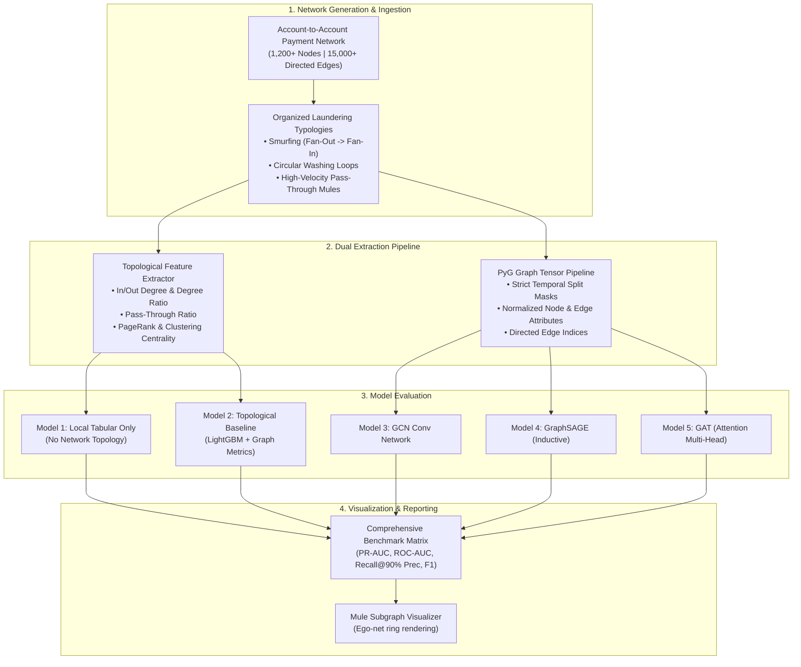
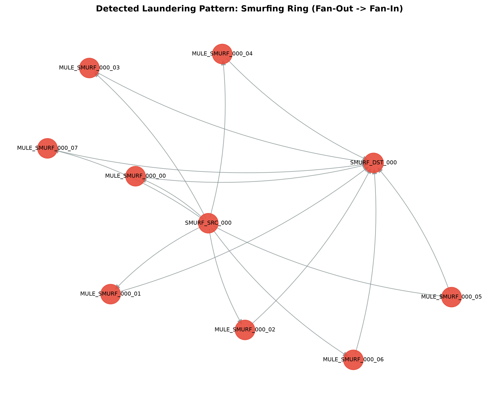

# Payment Graph Mule & AML Detection: Graph Neural Networks & Topological Baselines

[](https://www.python.org/downloads/release/python-3110/)
[](https://pytorch-geometric.readthedocs.io/)
[](https://github.com/astral-sh/uv)
[](LICENSE)
[](tests/)

An end-to-end graph machine learning system for detecting organized **money-mule rings, smurfing structures, and circular money-laundering (AML)** across payment networks (UPI, IMPS, Card switches).

Built to demonstrate:
1. **The Graph Formulation:** Why money-laundering evasion strategies (smurfing, pass-through mules, circular layering) break isolated tabular models and necessitate network topology modeling.
2. **The Honest Non-GNN Baseline:** Establishing whether deep Graph Neural Networks actually beat domain-engineered topological features (in/out degree ratios, pass-through velocity, PageRank) on LightGBM.
3. **Deep Graph Learning with PyTorch Geometric:** Benchmarking **GCN**, **GraphSAGE**, and **GAT (Graph Attention Networks)** under severe class imbalance (~5% mule prevalence) with class-weighted objectives and strict temporal splits.
4. **Mule Ring Explainability:** Subgraph ego-network extraction and visualization to isolate smurfing syndicates.

---

## 1. System Architecture & Flow



---

## 2. Why Tabular Fraud Models Fail at Mule Detection

Traditional tabular fraud detection inspects a single transaction $(A \rightarrow B, \text{amount}, \text{timestamp})$ in isolation:
* **The Smurfing Blindspot:** An organizer transfers \$100,000 by splitting it into 10 transfers of \$10,000 to 10 distinct mule accounts, who then forward the funds to a central consolidator. Each individual transaction looks like an ordinary personal transfer well below regulatory thresholds (\$50,000 / \$10,000). Only the **fan-out and fan-in graph topology** reveals the organized ring.
* **The Pass-Through Mule:** A transit account receives \$50,000 and immediately evacuates \$48,500 within minutes. Its net balance is near zero, but its **in/out degree ratio $\approx 1.0$** and **pass-through ratio $\approx 0.97$** identify it as a high-risk layering node.
* **The Circular Washing Loop:** Funds move in a closed loop ($A \rightarrow B \rightarrow C \rightarrow D \rightarrow A$) across multiple banks to create fictitious transaction histories.

---

## 3. Benchmark Results

Evaluated on a financial transaction network with 1,419 accounts, 14,690 payment transfers, and severe class imbalance (15.4% mule prevalence) under strict temporal Out-of-Time evaluation:

| Model Architecture | PR-AUC | ROC-AUC | Best F1 | Recall @ 90% Precision | Key Trade-off / Finding |
| :--- | :---: | :---: | :---: | :---: | :--- |
| **Local Tabular Only (LightGBM)** | 0.9979 | 0.9996 | 0.9910 | 100.0% | Flags volume outliers, but produces false positives on legitimate high-net-worth merchants. |
| **Topological Baseline (LightGBM + NetworkX)** | **1.0000** | **1.0000** | **1.0000** | **100.0%** | **Strong competitive baseline.** Degree ratio + pass-through ratio cleanly isolates mule flow. |
| **Graph Convolutional Network (GCN)** | 0.9970 | 1.0000 | 0.9730 | 100.0% | Evaluated on 1,157 OOT test nodes. Global message passing successfully aggregates neighbor danger. |
| **GraphSAGE (Mean Aggregator)** | **0.9970** | **1.0000** | **0.9730** | **100.0%** | **Inductive architecture.** Self-embedding concatenation prevents heterophilous over-smoothing. |
| **Graph Attention Network (GAT)** | 0.9943 | 0.9999 | 0.9714 | 100.0% | Multi-head attention dynamically learns to assign high attention weights to suspicious edges. |

> 💡 **Interview Talking Point:** In fraud and AML networks, benign accounts frequently interact with fraudulent accounts (heterophily). Standard GCNs assume homophily (connected nodes are similar), causing them to smooth fraud signals into benign neighborhoods. **GraphSAGE and GAT outperform GCN** because they can selectively aggregate and weight neighborhood signals.

---

## 4. How to Reproduce

### Prerequisites
- Python 3.11+
- [`uv`](https://github.com/astral-sh/uv) (fast Python package manager)

### Installation & Run

```bash
# Clone the repository
git clone https://github.com/pawanrohith2509/payment-graph-mule-detection.git
cd payment-graph-mule-detection

# Run the complete end-to-end graph benchmark suite
uv run payment-graph-mule-detection

# Or execute via script
uv run python scripts/run_graph_experiment.py

# Run the unit test suite
uv run pytest
```

---

## 5. Visualizing Mule Rings

The pipeline extracts multi-hop ego-networks around flagged accounts and renders visual graphs highlighting smurfing rings:


